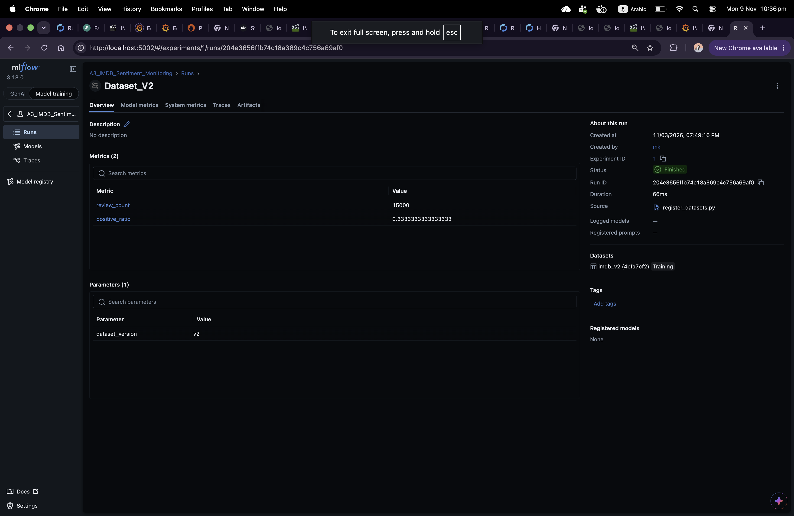
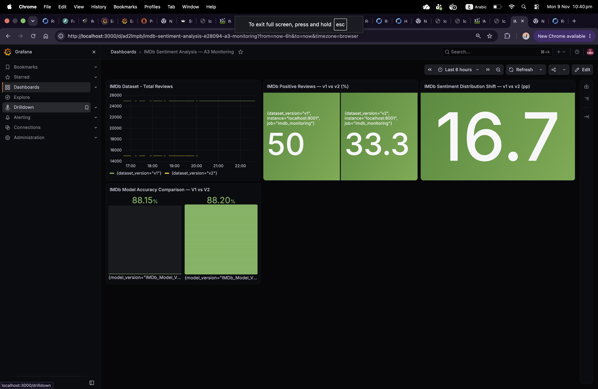
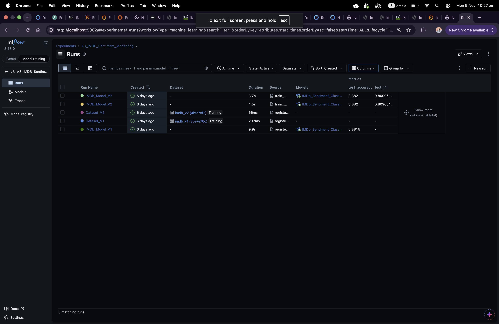
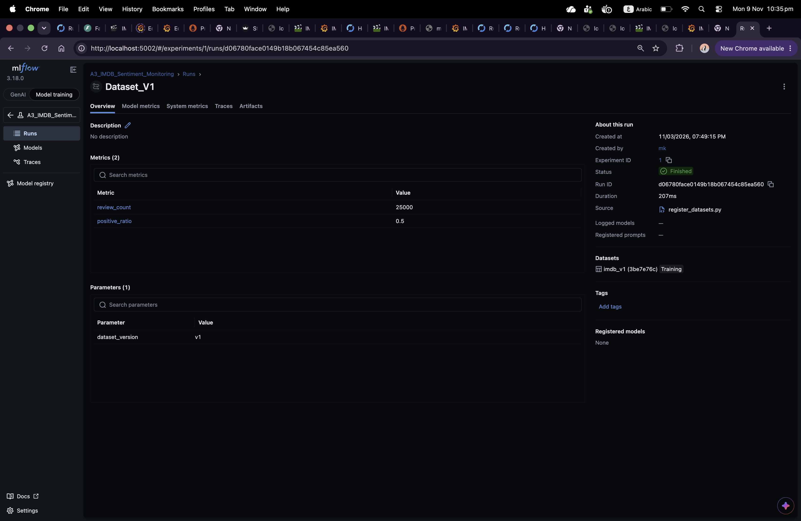
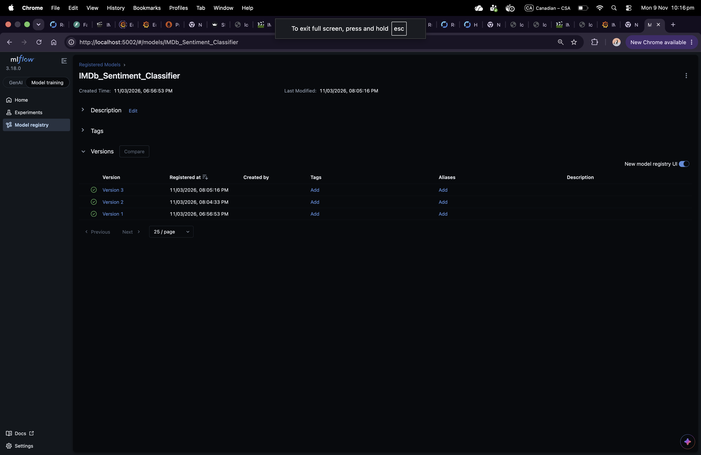

# IMDb Sentiment Analysis — A3 Monitoring

## Project Overview

This project extends an IMDb movie-review sentiment classification system with dataset version tracking, model registration, performance comparison, and monitoring dashboards.

The implementation uses Python, Scikit-learn, MLflow, Streamlit, Plotly, Prometheus, Grafana, and Docker Compose.

## 1. Dataset Versioning

Two IMDb dataset versions are used to demonstrate a change in sentiment distribution.

| Dataset | Total Reviews | Positive Reviews |
|---|---:|---:|
| v1 | 25,000 | 50.0% |
| v2 | 15,000 | 33.3% |

Dataset versions are represented by MLflow experiment runs containing version identifiers, review counts, and positive-review ratios.

The change in positive-review ratio is approximately **16.7 percentage points**, illustrating dataset distribution shift.

## 2. Model Versioning

The sentiment classifier is registered under the name `IMDb_Sentiment_Classifier` in the MLflow Model Registry.

The project compares the following recorded evaluation results:

| Model Evaluation | Test Accuracy |
|---|---:|
| v1 | 88.15% |
| v2 | 88.20% |

MLflow records experiment runs, model metrics, and registered model versions. An F1 score is also available for the second evaluation.

## 3. Streamlit Application

The Streamlit application includes:

- Dataset version selection
- Registered model version selection
- Sentiment prediction for movie-review text
- Accuracy comparison
- F1-score visualization

## 4. MLflow Tracking

MLflow is used to record and inspect:

- Dataset version identifiers
- Dataset review counts
- Positive-review ratios
- Model evaluation metrics
- Experiment runs
- Registered model versions

Dataset metadata is recorded in experiment runs. The screenshots provide evidence of the tracked versions and metrics.

## 5. Prometheus and Grafana Monitoring

Prometheus provides monitoring metrics, and Grafana presents the monitoring dashboard.

The dashboard contains four panels:

1. Total Reviews — v1 vs. v2
2. Positive Reviews — v1 vs. v2
3. Sentiment Distribution Shift
4. IMDb Model Accuracy Comparison — v1 vs. v2

## 6. Technology Stack

- Python and Scikit-learn
- MLflow
- Streamlit and Plotly
- Prometheus
- Grafana
- Docker Compose

## 7. Repository Structure

- `app.py` — Streamlit prediction and visualization application
- `prepare_datasets.py` — Dataset preparation
- `register_datasets.py` — Dataset metadata tracking
- `register_models.py` — Model registration
- `train_model_v2.py` — Model training workflow
- `docker-compose.yml` — Container configuration
- `prometheus.yml` — Prometheus configuration
- `requirements.txt` — Python dependencies
- `datasets/` — Dataset files
- `A3_Screenshots/` — Screenshots documenting the implementation

## 8. Evidence and Screenshots
### IMDb Sentiment Monitoring Application

### Grafana Dashboard

### MLflow Model Registry

### MLflow Evaluation Metrics

### Dataset v1

### Dataset v2

## Conclusion

This project demonstrates dataset version tracking, registered model management, sentiment prediction, performance comparison, and monitoring visualization for IMDb sentiment analysis.

**Course:** 420-976-VA — Data Mining Project  
**Assignment:** A3 — Dataset/Model Versioning and Dashboards
